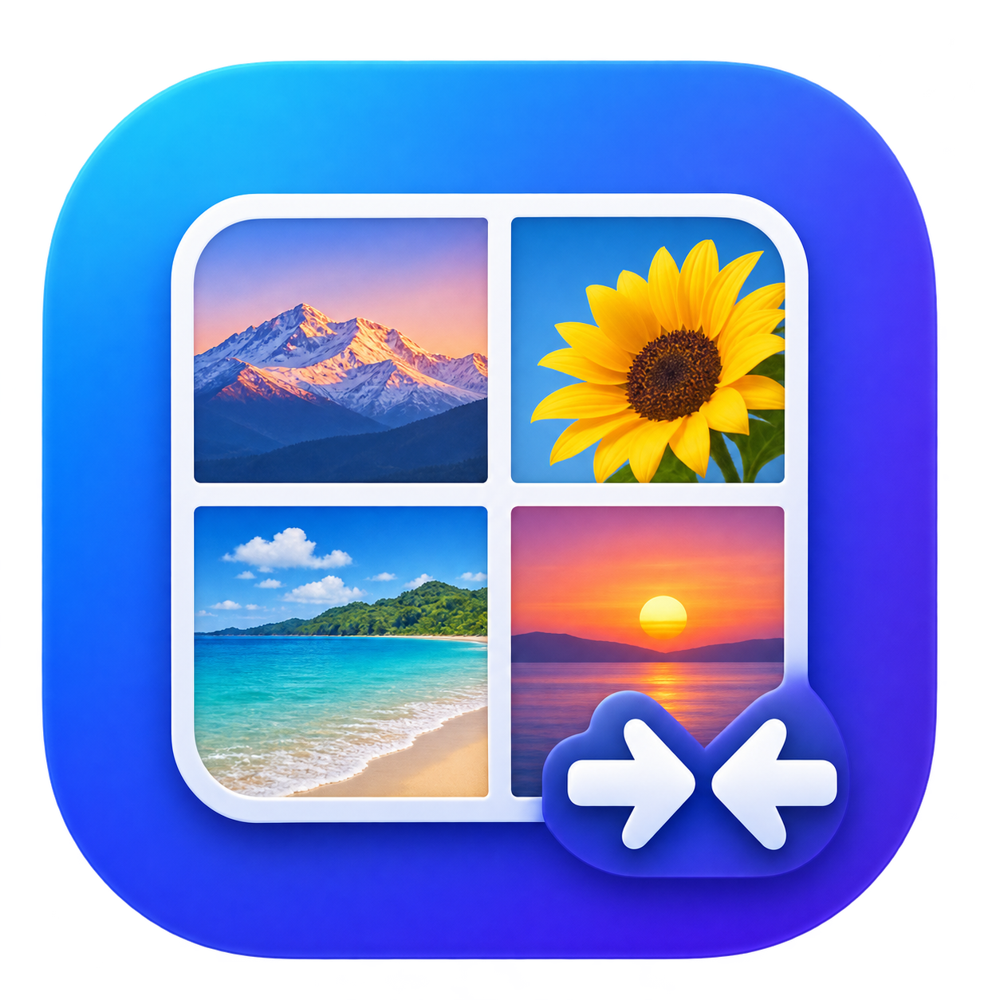

# 拼图与压缩



由梁粤Leo制作的 macOS 原生图片工具，把拼图、单图编辑和图片压缩放在同一个窗口里。拖入照片，调整排列与取景，再按需要的像素尺寸、文件大小和 JPEG 质量导出。

适合整理产品照片、制作测评配图、合并截图，以及处理有上传大小限制的图片。

## 拼图与编辑

- 支持水平、竖直和网格排列，以首图的显示高度为基准，其他图片按原比例等高排列。
- 图片可以直接拖入缩略图栏或预览区，支持一次添加多张和继续追加。
- 拖动缩略图即可排序，选中后可以点击「×」或按 Delete / Backspace 移除。
- 每张照片可放大到 100%–300%，放大后直接在预览里拖动，调整保留的画面。
- 支持上下左右四边裁切、90° 左右旋转、180° 旋转，以及水平和垂直镜像。
- 间距和边距使用成品像素，导出缩图时仍保持设定的留白。
- 拼图可以导出 PNG，也可以直接进入「压缩并导出」。

## 压缩与导出

- 压缩页的图片列表和上方预览区均支持拖入图片。列表每行带有缩略图和文件名，点击某行即可在上方查看对应图片的预览、尺寸和文件大小。
- 使用「移除所选」或 Delete / Backspace 从列表移除图片，支持 Command / Shift 多选。删除后自动选中相邻图片，原文件保留。
- 压缩操作处理列表中的全部图片，列表选中状态用于预览和移除。

- 支持设置最大宽度、最大高度和文件大小上限。
- 保存前显示试编码后的实际像素尺寸和文件大小。
- 拼图 JPEG 导出提供最高 100%、高 85%、中 70%、低 55% 四档质量。
- 文件上限较小时，会先调整编码质量，再缩小照片。拼图导出设有编码质量与自动缩图下限，无法满足时会提示调整设置。
- 可选择保存目录，批量压缩自动为同名结果编号。

## 多选与批量操作

- 压缩页从列表底部或最右侧空白处按住鼠标拖动，即可框选多行。选中后拖动任一选中行，可以整组调整清单顺序。
- 拼图页从缩略图栏空白处拖动，即可框选多张图片。选中后拖动任一选中缩略图，可以整组调整拼图顺序。
- 支持 Command 点选与 Shift 连续选择。多张选中时，Delete / Backspace 或移除按钮会移除整组，保留原文件。
- 两个页面共享图片清单和顺序，压缩页的清单调整也会同步到拼图页。

## 窗口操作

窗口右下角显示作者署名「by 梁粤Leo」，两个功能标签页共用该署名。

窗口可以自由放大、最小化或全屏，预览区域会随窗口大小扩展。右上角的「置顶」开关可让窗口保持在其他普通窗口上方。

点击窗口的红色关闭按钮时，可以选择关闭窗口、退出程序或取消。关闭窗口后，点击程序坞图标可继续编辑。

## 下载

[下载最新 macOS 通用版](https://github.com/LeoLeung89/collage-compress/releases/latest/download/CollageCompress-macOS-Universal.zip)

[查看所有版本](https://github.com/LeoLeung89/collage-compress/releases)

## 安装

1. 下载并解压应用 ZIP 包。
2. 将解压后的「拼图与压缩.app」拖入 Mac 的「应用程序」文件夹。
3. 从「应用程序」、程序坞或聚焦搜索中启动。

当前发布包是包含 arm64 和 x86_64 的 Universal 通用应用，最低系统版本为 macOS 11，面向 Apple Silicon 和 Intel Mac。构建已检查两种架构和最低系统版本，旧版 macOS 与 Intel 真机运行仍待验证。

应用使用本地完整性签名，尚未经过 Apple Developer ID 签名与公证。从互联网下载后，macOS 可能限制首次打开。

## 本地处理

使用 Swift、AppKit 和 ImageIO 构建。图片处理在本机完成，无需登录，也无需上传照片。

## 当前版本与限制

版本为 **v1.4.1**。

- 编辑状态保留在本次运行期间，退出程序后不会恢复。
- 旋转以 90° 为步进，动态图暂不支持。
- 拼图使用白色背景和 sRGB 输出。PNG 导出为 PNG，拼图压缩导出为 JPEG。
- 有损压缩、重采样或色彩空间转换会改变像素值，实际效果请结合预览检查。
- 项目使用 MIT 许可证，版权署名为梁粤Leo。详见 [LICENSE](LICENSE)。

## 从源码构建

安装 Xcode 或提供 Swift 编译器与 macOS SDK 的 Command Line Tools 后，在源码目录运行：

```sh
./build.sh
open build/拼图与压缩.app
```

构建脚本会生成适用于 macOS 11 及以上版本的 arm64 / x86_64 通用应用。

## 作者

梁粤Leo · by 梁粤Leo
